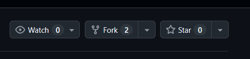
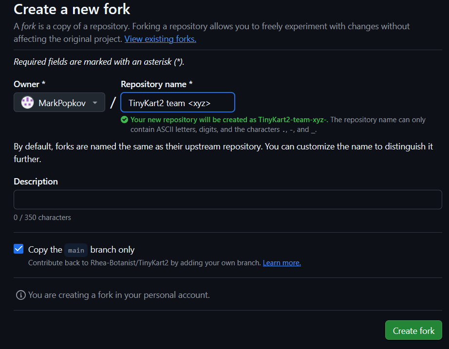
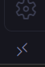

# Getting Started

**Forking the repository**

To make your own version of Tinykart for your team, open up the repo on Github, and click the "fork" button in the top-right

Name the fork whatever you would like, and finish by clicking "create fork"

This will allow you to have your own version of Tinykart 2, which you can develop independently from the other teams. You will also be able to pull any changes that get made to the main Tinykart 2 repository, such as bugfixes or documentation updates.

**Using git**

Git will be a very helpful tool for your team to develop code for Tinykart, sync changes, and bring over new changes that you can do remotely.

- Cloning the repository 
    - Cloning the Tinykart repository either onto your personal device or onto your Tinykart will copy the code onto the device, allowing you to make changes which you can then test or commit and push to your github fork
    - git clone [repository url]
    - you can find the repository url by going to the Github page and clicking on the green "Code" button
        - ISC uses and reccomends using SSH over HTML for the repository url
- Commiting changes
    - When you make changes to the code, you can make commitments to your local copy of the repository by adding changes, and commiting them to your current git branch
    - git add : adds changes to your staging area (anything in staging area is what gets commited when running git commit)
    - git commit -m "[commit message]" : commits the changes you added with git add to a commit
- Pushing and Pulling from the remote repository
    - Changes you commit to your local copy of the repository can be pushed to the remote repository on Github with git push, and you can pull changes from the remote with git pull
    - git push : pushes any commits you made on your current branch to an equivalent branch on the remote
    - git pull : pulls any new changes that have been made on the remote branch into your local copy
        - It is highly reccomended to do this before working on your local copy of the repository if you haven't worked on it in a while.
        - Making changes to an out-of-date branch and then trying to merge in the changes you forgot to pull can really suck!

**SSH**

You can use an SSH connection to your Tinykart to edit the code on the kart and run it. To establish the connection, make sure you are on the same network as the kart, and use one of the following methods:
- In the terminal:
    - In your terminal of choice, type: ssh [user]@[device]
    - device will either be the hostname or IP address of your tinykart
- In your IDE (VSCode example):
    - Most IDEs/Code editors allow you to connect to another device through SSH and edit code directly on the device.
    - In VSCode, this can be done by pressing on the remote window button in the very far left of the screen, which will ask you to either add a remote host, or connect to a known host
        - If you have never used VSCode to connect to your Tinykart, then start by adding a remote host, and input the information it asks for, such as hostname
        - After you have your kart added as a known host, you may have to click on the remote window button again, but now you can connect to your kart, either in your current VSCode window or in a new one
    - After you connect, you can navigate to your ROS2 workspace in VSCode and begin to work on your kart, or run it *(refrence the README in the main part of the repo for building and running instructions!)*
    

*The remote window button in VSCode